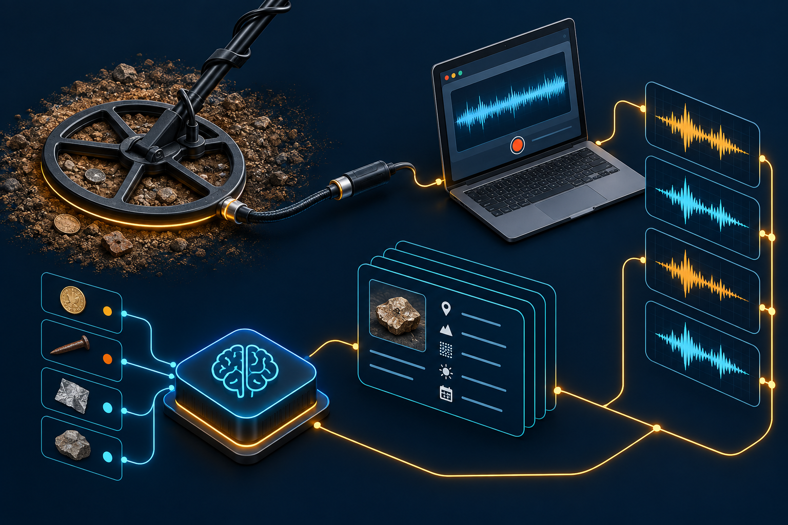
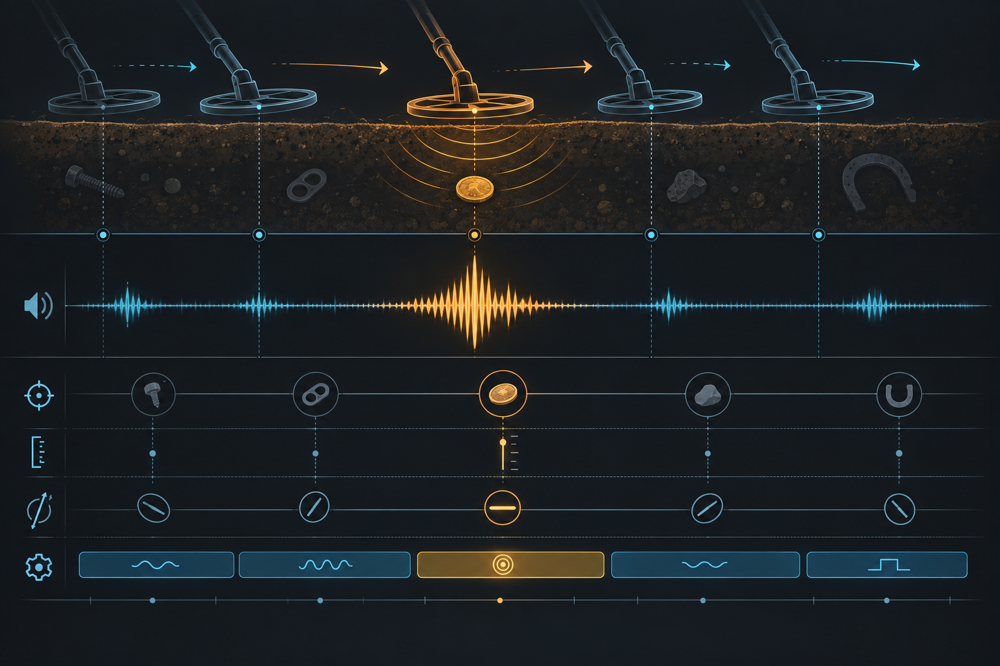
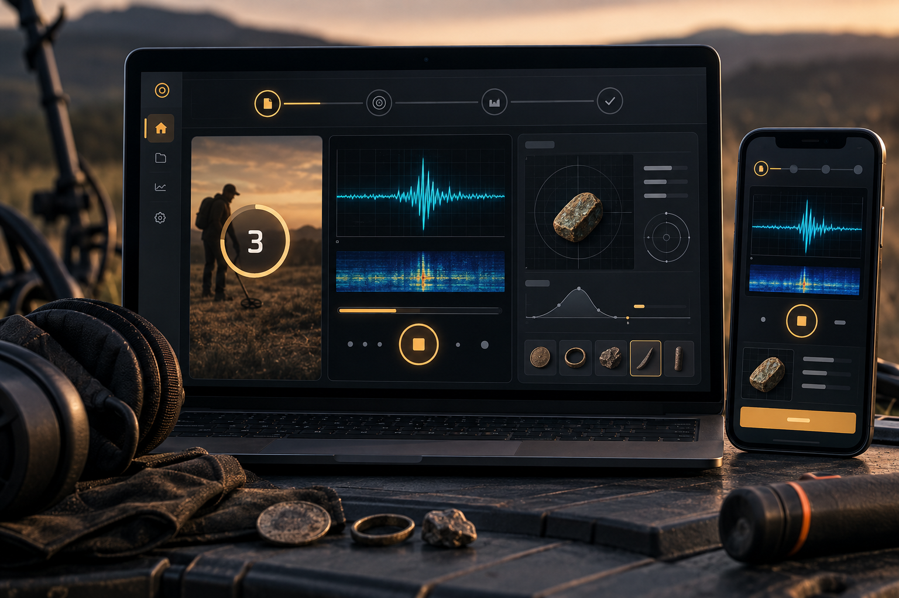

# Signal Lab


> **Signal Lab** convierte una búsqueda de campo en un dataset de audio reproducible. La aplicación funciona en el navegador, mantiene las grabaciones en local y deja cada toma unida a su objetivo, detector, profundidad, orientación y maniobra.

[](#estado) [](#cómo-funciona) [](LICENSE)

## Por qué existe

Los detectores económicos suelen condensar mucha información en una respuesta sonora aparentemente sencilla. El objetivo de este proyecto es capturar esa señal con un protocolo estable, conservar su contexto y preparar una base sólida para experimentar después con extracción de características y modelos de IA.

La aplicación no promete identificar metales mágicamente. Primero construye evidencia: sesiones comparables, metadatos completos y una separación clara entre audio observado, contexto de campo e inferencias futuras.

## La versión avanzada

La versión 2.0 añade una arquitectura cognitiva local-first:

- **Protocolo guiado:** 3 orientaciones × 4 maniobras = 12 tomas por ciclo; la maniobra zigzag dura 15 segundos y las demás 10.
- **Perfiles de detector:** TX-850 y GC-1065 Genérico, con un contrato preparado para incorporar más modelos.
- **Dos modos:** cable de audio para máxima fidelidad y manos libres para capturas de referencia menos sensibles.
- **Proveniencia:** esquema, fuente, duración real, entrada de audio y calidad quedan junto al manifest.
- **Persistencia local:** IndexedDB para audio y sesiones; no se envía nada a un servidor de forma automática.
- **Exportación explícita:** manifest JSON y último audio para revisar, versionar o alimentar un pipeline externo.
- **Compatibilidad hacia atrás:** la documentación de la primera etapa se conserva en [`versions/v1-legacy`](versions/v1-legacy/README.md); la nueva arquitectura evoluciona por contrato, no por borrado.



## Inicio rápido

Requisitos: Node.js 20 o superior y un navegador con `MediaRecorder`, `getUserMedia` e IndexedDB.

```bash
npm test
npm run check
npm start
```

Abre `http://localhost:4173`. Para capturar por cable, conecta la salida del detector a una entrada de línea/micrófono segura y selecciona la entrada correcta en la aplicación. Comprueba primero el nivel con el detector sin objetivo.

## Cómo funciona

1. Elige el detector, el modo y la profundidad de referencia (5 cm por defecto).
2. Escribe el objetivo: una moneda, un anillo, una chapa o cualquier muestra que quieras comparar.
3. Pulsa **Crear sesión**. La guía presenta la orientación y la maniobra actual.
4. Captura cada toma. El navegador muestra el tiempo, guarda el audio en IndexedDB y añade un registro al manifest.
5. Exporta el manifest cuando hayas revisado el ciclo. Los audios permanecen locales hasta que decidas extraerlos.



Cada observación está pensada como tres capas sincronizadas:

| Capa | Qué contiene | Uso futuro |
| --- | --- | --- |
| Señal | Audio original del dispositivo de captura | espectrogramas, envolventes, embeddings |
| Contexto | objetivo, orientación, profundidad, maniobra y modo | agrupación, control de sesgos, splits |
| Proveniencia | versión, dispositivo, duración y calidad | auditoría, reproducibilidad y depuración |

## Arquitectura del repositorio

```text
src/
  core/              dominio puro: protocolo, sesiones y validación
  adapters/          MediaRecorder, IndexedDB y exportación
  ui/                renderizado de la guía y biblioteca local
  main.js            composición de la aplicación
docs/                contratos, arquitectura y protocolo de campo
versions/v1-legacy/ decisiones y formato histórico conservados
public/images/       cabecera y visuales explicativos generados para el proyecto
scripts/             servidor local y comprobaciones reproducibles
test/                pruebas del dominio sin navegador
```



## Diseño cognitivo

La aplicación separa cuatro responsabilidades para que una futura IA no confunda la señal con el contexto que la produjo:

1. **Observación:** captura el audio sin aplicar filtros silenciosos.
2. **Contextualización:** registra qué se buscaba, con qué detector y bajo qué maniobra.
3. **Memoria:** mantiene sesiones y blobs enlazados por identificadores estables.
4. **Evaluación:** valida el manifest antes de exportarlo y deja la inferencia de material para una etapa posterior.

Más detalle en [`docs/architecture.md`](docs/architecture.md) y [`docs/dataset-spec.md`](docs/dataset-spec.md).

## Seguridad y límites

- La app solicita permiso de micrófono sólo cuando inicias una toma.
- No hay backend ni subida automática.
- La conexión directa a una bobina o a un punto de prueba debe hacerse con una interfaz de alta impedancia y protección adecuada; este repositorio captura audio, no sustituye un osciloscopio ni un circuito de aislamiento.
- Las identificaciones de metal son una hipótesis de investigación, no una garantía de campo.

## Estado

**v2.0.0 · lista para captura local.** El siguiente bloque de trabajo es añadir un exportador ZIP/CSV y un pipeline reproducible de características (RMS, envolvente, espectrograma y eventos de señal) antes de entrenar cualquier clasificador.

## Contribuir

Lee [`AGENTS.md`](AGENTS.md), [`CONTRIBUTING.md`](CONTRIBUTING.md) y el contrato de datos antes de proponer cambios. Ejecuta siempre `npm test` y `npm run check`.

## Licencia

Apache-2.0. Consulta [`LICENSE`](LICENSE).
